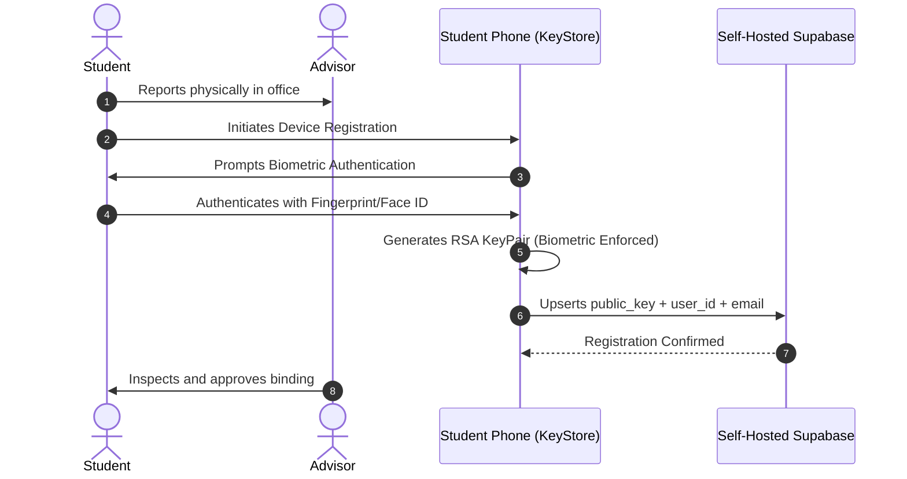
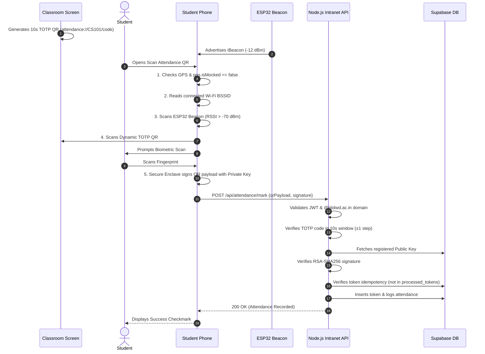

# System Architecture & Technical Specifications

This document outlines the High-Level Design (HLD) and Low-Level Design (LLD) of the **Cheat-Proof Indoor Attendance System (ATS)**.

---

## 1. High-Level Architecture (HLD)

The system enforces physical and cryptographic attendance validation using a **Defense-in-Depth** model across 6 distinct validation barriers.

```
                     ┌─────────────────────────────────────────────────────────┐
                     │                  University Classroom                   │
                     │  ┌─────────────────────────┐  ┌──────────────────────┐  │
                     │  │ Teacher Projector Screen│  │ ESP32 iBeacon Unit   │  │
                     │  │ (Dynamic QR TOTP 10s)   │  │ (-12dBm BLE TX Power)│  │
                     │  └────────────┬────────────┘  └──────────┬───────────┘  │
                     └───────────────┼──────────────────────────┼──────────────┘
                                     │ Optical Scan             │ BLE Radio Signal
                                     ▼                          ▼
┌────────────────────────────────────────────────────────────────────────────────────────┐
│                              Student Mobile Device                                     │
│  ┌───────────────────────┐  ┌─────────────────────────┐  ┌──────────────────────────┐  │
│  │ 1. GPS + Mock Check   │  │ 2. Router BSSID Match   │  │ 3. BLE RSSI > -70 dBm    │  │
│  │ (Geofence ≤ 150m)     │  │ (Hardware AP Pinning)   │  │ (Physical Room Presence) │  │
│  └───────────┬───────────┘  └────────────┬────────────┘  └────────────┬─────────────┘  │
│              │                           │                            │                │
│  ┌───────────▼───────────────────────────▼────────────────────────────▼─────────────┐  │
│  │ 4. Hardware Key Signature (Biometric Fingerprint + Secure Enclave / KeyStore)    │  │
│  └───────────────────────────────────────┬──────────────────────────────────────────┘  │
└──────────────────────────────────────────┼─────────────────────────────────────────────┘
                                           │ Encrypted JSON over Local Wi-Fi (Intranet)
                                           ▼
                     ┌─────────────────────────────────────────────────────────┐
                     │              University Intranet Server                 │
                     │  ┌─────────────────────────┐  ┌──────────────────────┐  │
                     │  │ Node.js Intranet API    │  │ Self-Hosted Supabase │  │
                     │  │ (TOTP + RSA Signature)  │  │ (PostgreSQL + Auth)  │  │
                     │  └─────────────────────────┘  └──────────────────────┘  │
                     └─────────────────────────────────────────────────────────┘
```

---

## 2. Network Separation & Protocol Matrix

To prevent proxying, remote submission, and spoofing, the system strictly separates **Public Internet** dependency from **Campus Local Intranet** traffic:

| Barrier / Layer | Physical Medium | Network Dependency | Cryptographic / Hardware Primitive | Anti-Cheat Objective |
|---|---|---|---|---|
| **Google Workspace Auth** | HTTPS / TLS 1.3 | **Internet Required** | OAuth 2.0 / PKCE (`@iiitdwd.ac.in`) | Verifies authentic student identity |
| **GPS Geofence & Mock Check** | GNSS Satellite Receiver | **Device Hardware** | Android `Location.isMocked` & iOS core location | Prevents remote attendance outside campus |
| **Wi-Fi BSSID Check** | 802.11 Wi-Fi PHY | **Local Wi-Fi Only** | Router hardware MAC address matching | Binds device to classroom access point |
| **ESP32 iBeacon Check** | 2.4 GHz Bluetooth LE | **No Network (Radio)** | Apple iBeacon format, calibrated RSSI > -70 dBm | Ensures physical room presence; wall attenuation |
| **Dynamic QR Code** | Optical Camera Scan | **Visual Only** | 10-second rolling TOTP (SHA-256) | Eliminates photo forwarding and static token reuse |
| **Hardware Key Biometric Sign** | ARM TrustZone / Secure Enclave | **Device Silicon** | Asymmetric 2048-bit RSA with biometric gating | Binds identity to specific phone hardware |
| **Intranet Server Validation** | Local Subnet HTTP | **Intranet Only** | RSA-SHA256 signature verification & token table | Eliminates remote internet API marking |

---

## 3. Cryptographic Identity & Device Pinning (LLD)

### Asymmetric Key Generation
During one-time Advisor Registration:
1. The student device calls `biometric_signature.createKeys()`.
2. The OS hardware security module (Apple Secure Enclave or Android KeyStore) provisions an RSA-2048 key pair inside tamper-resistant hardware.
3. The key is instantiated with:
   ```kotlin
   KeyGenParameterSpec.Builder(alias, KeyProperties.PURPOSE_SIGN)
       .setUserAuthenticationRequired(true)
       .setInvalidatedByBiometricEnrollment(true) // Android KeyStore
   ```
4. **The private key never leaves hardware.**
5. The student uploads only the **Public Key** to the university Supabase `student_devices` table.

### Biometric Invalidation Trigger
If a student enrolls a friend's fingerprint on their phone, the operating system kernel marks the hardware key permanently invalidated (`KeyPermanentlyInvalidatedException`). Subsequent attendance attempts fail immediately, requiring a complete advisor re-enrollment.

---

## 4. End-to-End Sequence Diagrams

### 4.1 Device Registration Flow (Advisor Presence)


### 4.2 Daily Attendance Mark Flow


---

## 5. Security & Threat Modeling Matrix

| Threat Vector | Attack Scenario | Defense Mechanism |
|---|---|---|
| **Remote Proxy** | Student outside campus sends credentials to a friend | Hardware Private Key is non-exportable; friend cannot sign on their phone. |
| **GPS Spoofing** | Student runs mock location / Fake GPS app | `pos.isMocked` check drops the request; BSSID & BLE layers fail. |
| **Photo Forwarding** | Student takes photo of screen QR and sends via WhatsApp | Rolling 10s window expires code before it can be scanned and processed. |
| **Hallway Sniffing** | Student stands outside classroom door in corridor | ESP32 TX power tuned to -12 dBm; concrete wall drops RSSI below -70 dBm. |
| **Token Replay** | Student intercepts signed HTTP packet and resubmits | `processed_tokens` table enforces strict token uniqueness. |
| **Friend Biometric** | Student registers friend's fingerprint on phone | `setInvalidatedByBiometricEnrollment = true` permanently destroys the key. |
| **Internet Injection**| Attacker attempts to hit marking API from public internet | API server is bound strictly to campus intranet subnet (`192.168.10.x`). |
